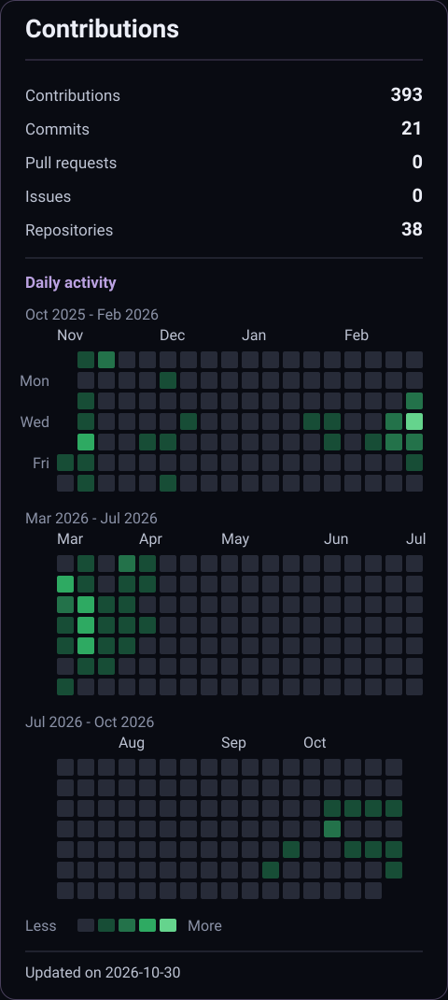
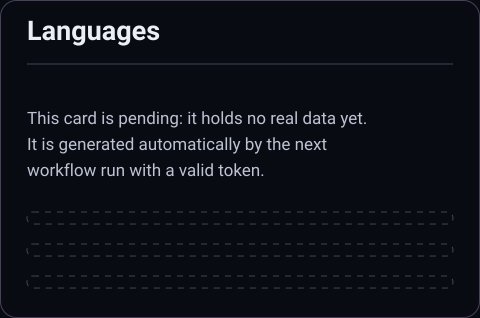

<!-- Banner -->
<div align="center">
  
</div>

<br><br/>

***


<h2 align="center">Hi!! 👋, I'm Leandro!!</h2>


<p align="center">
Multiplatform App Developer with a background in aeronautics. 
Passionate about software, aviation, and AI.<br><br/> 
</p>


<br><br/>
```java
import java.time.LocalTime;

public class LeanEmanuel {
    private final String name = "Leandro Emanuel";
    private final String city = "Barcelona";
    private final String[] stack = {"Java", "Kotlin", "React Native", "Angular", "Python", "Laravel"};

public String getStatus() {
    int hour = java.time.LocalTime.now().getHour();
    if (hour >= 7 && hour <= 15) return "☕ Working!";
    if (hour >= 15 && hour <= 22) return "🚀 Improving my skills!";
    return "🌙 Resting...";
}

    public static void main(String[] args) {
        LeanEmanuel profile = new LeanEmanuel();
        System.out.println(profile.getStatus());
    }
}
```


<br><br/>

***

<h2 align="center">🧰 Tech Stack</h2>

<br/>

<p align="center">
  <b>Languages</b><br/>
  
</p>

<br/>

<p align="center">
  <b>Mobile &amp; Web</b><br/>
  
</p>

<br/>

<p align="center">
  <b>Data &amp; Tools</b><br/>
  
</p>

<br><br/>

***
<!-- Stats -->
<p align="center">
  
</p>

<p align="center">
  
</p>


<!--
***
Spotify 
<table align="center">
  <tr>
    <td align="center">
      <a href="https://spotify-github-profile.kittinanx.com/api/view?uid=1151426230&redirect=true">
        
      </a>
    </td>
</tr>
</table>
-->

***

<!-- Logo Link GitHub -->
<table align="center">
  <tr>
    <td align="center">
      <a href="https://github.com/LeanEmanuel">
        
      </a>
    </td>
</tr>
<tr>
  <td>
    <a href="https://github.com/LeanEmanuel">
      
    </a>
  </td>
</tr>
</table>

<!-- Gif Java Assassins -->
<br>
<div align=center>
  
</div>
<br>


<!--
**LeanEmanuel/LeanEmanuel** is a ✨ _special_ ✨ repository because its `README.md` (this file) appears on your GitHub profile.

Here are some ideas to get you started:

- 🔭 I’m currently working on ...
- 🌱 I’m currently learning ...
- 👯 I’m looking to collaborate on ...
- 🤔 I’m looking for help with ...
- 💬 Ask me about ...
- 📫 How to reach me: ...
- 😄 Pronouns: ...
- ⚡ Fun fact: ...
-->
