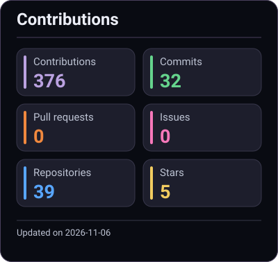
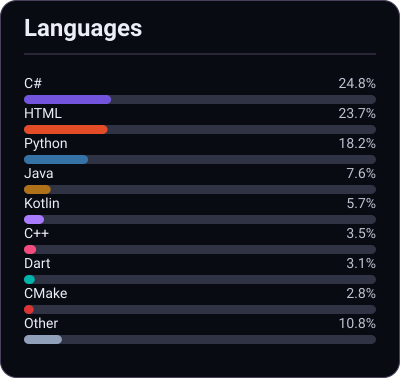

<!-- Banner -->
<div align="center">
  
</div>

***

<h2 align="center">Hi!! 👋, I'm Leandro!!</h2>

<p align="center">
Multiplatform App Developer with a background in aeronautics.<br/>
Passionate about software, aviation, and AI.
</p>

```java
import java.time.LocalTime;

public class LeanEmanuel {
    private final String name = "Leandro Emanuel";
    private final String city = "Barcelona";
    private final String[] stack = {"Java", "Kotlin", "React Native", "Angular", "Python", "Laravel"};

    public String getStatus() {
        int hour = LocalTime.now().getHour();
        if (hour >= 7 && hour < 15) return "☕ Working!";
        if (hour >= 15 && hour < 22) return "🚀 Improving my skills!";
        return "🌙 Resting...";
    }

    public static void main(String[] args) {
        LeanEmanuel profile = new LeanEmanuel();
        System.out.println(profile.getStatus());
    }
}
```

***

<h2 align="center">🧰 Tech Stack</h2>

<p align="center">
  <b>Languages</b><br/>
  
</p>

<p align="center">
  <b>Mobile &amp; Web</b><br/>
  
</p>

<p align="center">
  <b>Data &amp; Tools</b><br/>
  
</p>

***

<!-- Stats -->
<p align="center">
   &nbsp;&nbsp; 
</p>


<!--
***
Spotify 
<table align="center">
  <tr>
    <td align="center">
      <a href="https://spotify-github-profile.kittinanx.com/api/view?uid=1151426230&redirect=true">
        
      </a>
    </td>
</tr>
</table>
-->

***

<!-- Signature -->
<p align="center">
  <a href="https://github.com/LeanEmanuel">
    
  </a>
</p>

<h3 align="center">Leandro Emanuel</h3>

<p align="center">
  <sub>Multiplatform developer · Barcelona</sub>
</p>

<p align="center">
  <a href="https://github.com/LeanEmanuel"></a>
  <a href="https://www.linkedin.com/in/leandro-struni/"></a>
</p>

<!-- Gif Java Assassins -->
<br>
<div align=center>
  
</div>
<br>
